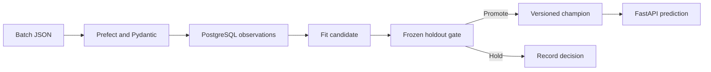

# AbFlow

Synthetic observation ingestion and model promotion. A Prefect flow validates JSON with Pydantic and fits a regression model on versioned PostgreSQL observations. The candidate is measured against a frozen holdout. An improvement greater than 0.01 RMSE promotes the candidate. FastAPI reads the latest committed model version at request time. The promotion and batch write share one transaction and a database lock. Replaying the same batch returns its original result.



Run the two-batch demo and request a prediction.

```bash
docker compose up -d --build
docker compose run --rm api python pipeline.py
curl -X POST http://localhost:8000/predict -H 'Content-Type: application/json' -d '{"features":[0,0,0]}'
```

The demo prints the candidate RMSE, promotion decision, champion version, and feature drift. Drift flags a maximum standardized mean shift above 1.0 relative to prior observations. PostgreSQL acts as the model registry in this demo. CI exercises validation, batch replay, promotion, rejection, and the API contract with PostgreSQL, then builds the container and validates Terraform.

The ECS template expects existing private subnets, security groups, a reachable database, a Secrets Manager secret containing the database URL, an execution role with access to that secret and ECR, and a pushed image. The template provisions a private Fargate service. The published demo runs with Docker and GitHub Actions.

## Verified demo

| Batch | Training rows | Frozen holdout RMSE | Decision |
| --- | ---: | ---: | --- |
| Initial | 32 | 0.3000 | Promote version 1 |
| Follow-up | 64 | 0.1505 | Promote version 2 |

The integration test also confirms a worse candidate keeps the current champion and that replaying the same batch returns the original result. The workflow builds the Docker image and validates the ECS Terraform configuration.

[Verified integration, demo and build](https://github.com/jatinmallarapu/AbFlow-Synthetic-Assay-MLOps-for-Model-Retraining-and-Deployment/actions/runs/43386934823)
